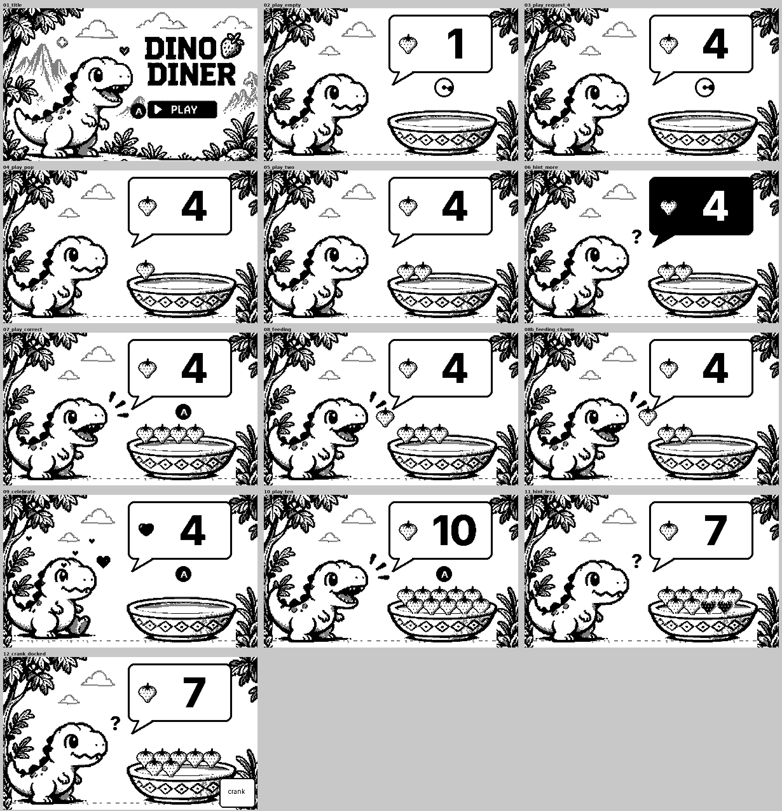

# Design review

Reviewed every screen against the art-direction mockup
(`tools/reference/mockup.png`) and the spec's preschool UX goals. The
screens come from `preview/`, which is rendered from main.lua's real draw
calls by a mock renderer, not the Playdate Simulator.

## Fixed in this pass

| # | Finding | Fix |
|---|---|---|
| 1 | The goal-strawberry row under the bubble repeated what the bowl already shows. Two sets of strawberries to track is more noise than help. | Removed the row. The bubble numeral and the bowl are the only quantities on screen. |
| 2 | Removing the row left dead space between the bubble and the bowl. The bubble and numeral were small next to the mockup's chunky "4". | Bubble is larger (164×92). Numerals are 64 px instead of 46 px. |
| 3 | The crank and A prompts sat in the top-right corner, outside the child's line of sight (bubble → bowl). | Prompts are now centered between the bubble and the bowl, where the berries land. The celebration's "press A" uses the same spot. |
| 4 | The bubble tail ran into the dino's "!" excitement marks. | Tail is re-aimed so its tip clears the marks. |
| 5 | After "need more", the number blinked off, leaving an empty bubble. | The bubble now flips to black with a white numeral. The number stays readable and the change still catches the eye. |
| 6 | Without the slot row, "too many" had no visual cue. | Extra berries are drawn dark in the bowl and blink after a "too many" answer. |
| 7 | **Audio:** the espeak voice was robotic, and the effects were raw square and sine blips with hard edges. | New warm neural voice (Kokoro `af_heart`, lifted slightly in pitch) and friendlier wording ("Ooh, I need a few more!", "Oopsie, that's too many!"). Effects are rebuilt as soft bloops, boops, noms and a marimba cheer, with fades on every clip. |

## Still open (needs hardware or a judgment call)

- **10 berries in the bowl:** the front row hides the lower half of the
  back row. All ten are still countable in the preview, but check this on
  the real screen. If it's too busy, shrink the berries to about 26 px or
  use three rows.
- **Numeral style:** Inter ExtraBold is smoother than the chunky pixel
  logo. A custom pixel numeral set would match the mockup more closely.
- **Ground line:** the dashed pebble line under the scene reads a little
  mechanical next to the hand-drawn foliage.
- **Dark "extra" berries** look somewhat like dark hearts at 1x. A small
  "x" or a lift-out animation might read more clearly as "take this one
  out".
- **Audio has not been checked by ear** in this environment. Listen
  especially for:
  - pronunciation of the numbers
  - whether the pitch lift sounds natural
  - balance between the voice and the effects on the Playdate speaker
- **Not yet run in the Simulator or on hardware**, so:
  - crank feel (10 ticks per turn)
  - animation timing
  - legibility on the reflective LCD
